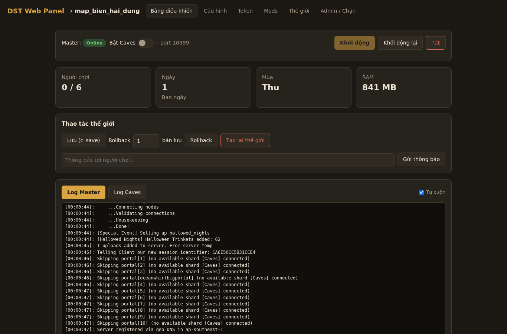
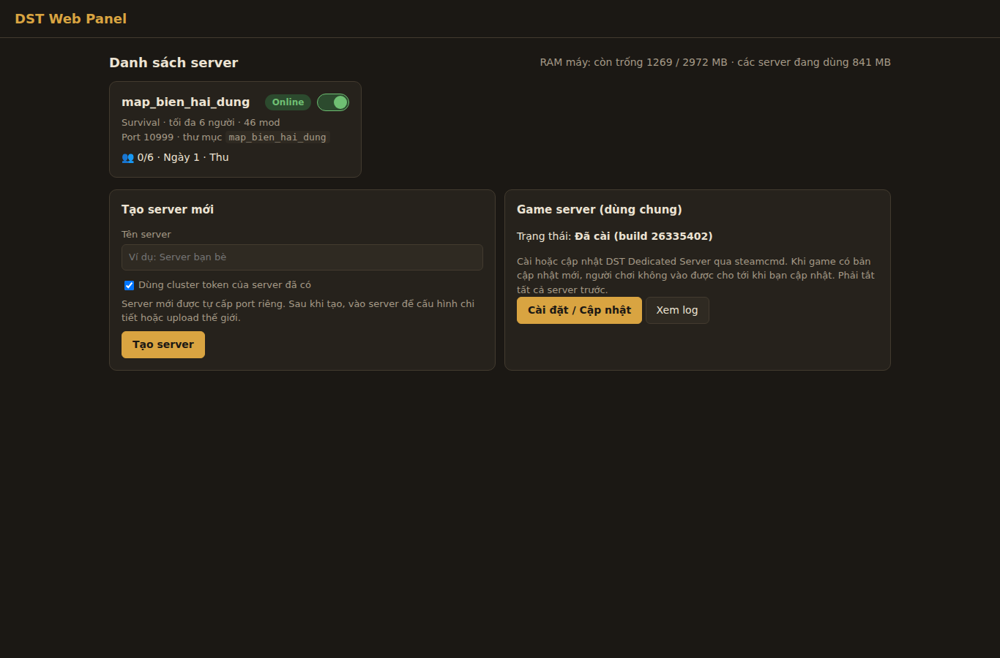
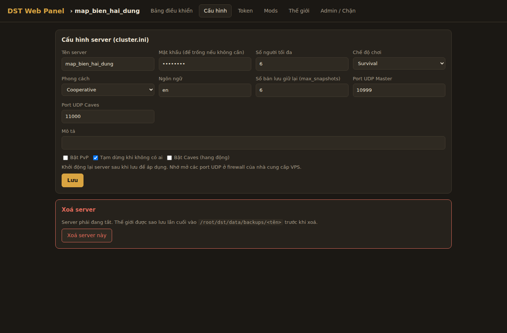
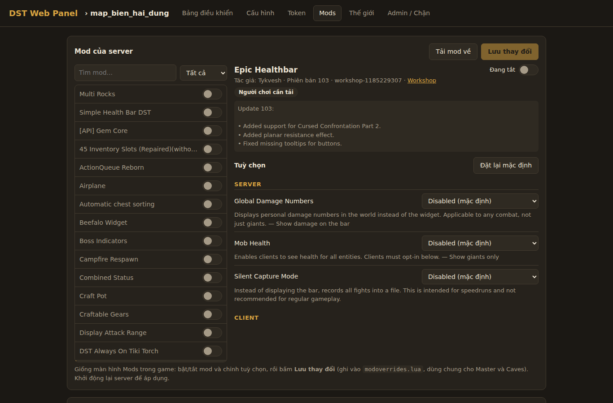
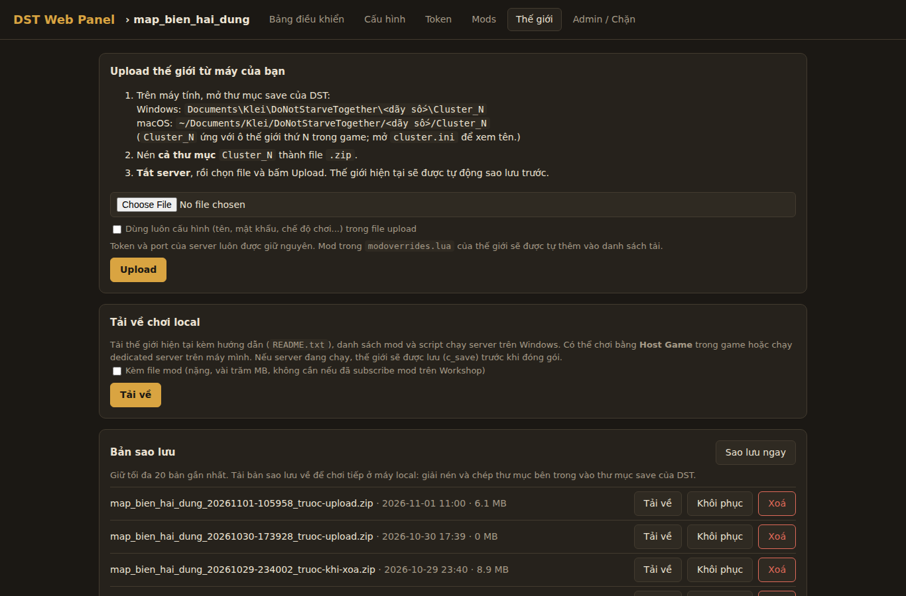

# DST Dedicated Linux Server Manager

[Tiếng Việt](README.md) | **English**



A web panel for managing multiple **Don't Starve Together Dedicated Servers** on Linux. It is built with Python (FastAPI) as a single `app.py` plus one page, `static/index.html`, and needs no database.

> The interface is currently in Vietnamese only.

The shard management approach (sending commands through stdin, parsing logs, injecting Lua to collect stats) is based on [vox-launcher](https://github.com/diogo-webber/vox-launcher), rewritten for Linux and the web.

## Features

- **Multiple servers on one machine**: each server (cluster) has a Master shard and an optional Caves shard, and gets its own set of ports automatically so they never clash.
- **Game install and updates**: downloads SteamCMD and DST Dedicated Server (app 343050) for you. The panel checks for a new build every 30 minutes. When nobody is playing, it restarts running servers to update them.
- **Dashboard**: start, stop and restart each server, toggle Caves, follow each shard's log live, send console commands, and see player count and world stats.
- **World actions**: save, roll back (1–10 snapshots), regenerate the world, and broadcast announcements in game.
- **Configuration**: edit `cluster.ini` through a form (name, description, password, game mode, max players, PvP...), and edit `worldgenoverride.lua` for the surface and the caves.
- **Workshop mods**: add mods by ID, download them with SteamCMD, and configure them in the browser. The panel reads `modinfo.lua` in a Lua sandbox, and `modoverrides.lua` is synced to Caves.
- **Player lists**: adminlist, blocklist and whitelist.
- **Cluster token**: enter the token once and reuse it when creating new servers.
- **Backups**: create, download, restore and delete backups (the 20 most recent are kept).
- **World upload**: upload a `.zip` (up to 1 GB) to import a world from your own computer.
- **Download to play locally**: export a server as a zip (optionally with mods), with instructions and a `start_server.bat` so you can keep playing on Windows or macOS.
- **Login**: HTTP Basic Auth.

## Screenshots

| Server list | Configuration |
|---|---|
|  |  |
| **Mods** | **World & backups** |
|  |  |

## Requirements

- Linux x86_64 (tested on Ubuntu)
- Python 3.10 or newer
- 32-bit libraries for SteamCMD, for example on Ubuntu/Debian:

  ```bash
  sudo dpkg --add-architecture i386
  sudo apt update
  sudo apt install lib32gcc-s1 libcurl4-gnutls-dev:i386 python3-venv
  ```

- About 5–10 GB of free disk space for the game and mods

## Directory layout

By default the panel uses `/root/dst`. Set the `DST_BASE` environment variable to change it.

```
/root/dst/
├── webui/      # this repo
├── server/     # DST Dedicated Server (installed by the panel)
├── steamcmd/   # SteamCMD (downloaded by the panel)
├── workshop/   # mods downloaded from the Workshop
└── data/
    ├── DoNotStarveTogether/   # clusters
    └── backups/               # backups
```

## Installation

```bash
mkdir -p /root/dst && cd /root/dst
git clone git@github.com:phanhoanghai90/dst_dedicated_linux_server_manager.git webui
cd webui

python3 -m venv .venv
.venv/bin/pip install -r requirements.txt
```

Test run:

```bash
.venv/bin/python app.py
```

Open `http://<server-ip>:8080`. On first run, the panel creates `config.json` with the user `admin` and a random password:

```bash
cat config.json
```

To change the login, edit this file and restart the panel. The file is already listed in `.gitignore`.

Then, in the browser:

1. Click install game server (the first install takes a few minutes).
2. Create a new server.
3. Open the **Token** tab and enter your cluster token. Get one in game under *Account → Generate Server Token*, or at [accounts.klei.com](https://accounts.klei.com/account/game/servers?game=DontStarveTogether).
4. Turn the server on.

## Running as a service (systemd)

```bash
cp deploy/dst-webui.service /etc/systemd/system/
systemctl daemon-reload
systemctl enable --now dst-webui
```

If you installed somewhere other than `/root/dst/webui`, update `WorkingDirectory` and `ExecStart` in the service file.

To restart the panel, run `./restart.sh`. Note: running game servers are saved and stopped along with it.

View logs:

```bash
journalctl -u dst-webui -f
```

## Environment variables

| Variable   | Default     | Meaning                              |
|------------|-------------|--------------------------------------|
| `DST_BASE` | `/root/dst` | Root folder for the game and data     |
| `HOST`     | `0.0.0.0`   | Address the panel listens on          |
| `PORT`     | `8080`      | Web panel port                        |

## Ports to open

Port **8080/TCP** is for the web panel. Game ports use **UDP**, and each server takes one slot (`n` = 0, 1, 2...):

| Shard  | server_port     | master_server_port | authentication_port |
|--------|-----------------|--------------------|---------------------|
| Master | `10999 + 2n`    | `27018 + 2n`       | `8768 + 2n`         |
| Caves  | `11000 + 2n`    | `27019 + 2n`       | `8769 + 2n`         |

Example with `ufw`, opening ports for the first 5 servers:

```bash
ufw allow 8080/tcp
ufw allow 10999:11008/udp
ufw allow 27018:27027/udp
ufw allow 8768:8777/udp
```

## Security

- Basic Auth is only encrypted over HTTPS. If you expose the panel to the Internet, put it behind a reverse proxy with TLS (Caddy, Nginx), or reach it only through a VPN or SSH tunnel.
- The service runs as `root` by default. You can create a dedicated user and change `DST_BASE` to limit its permissions.

## Notes

Don't Starve Together is a trademark of Klei Entertainment. This project is not affiliated with Klei.
