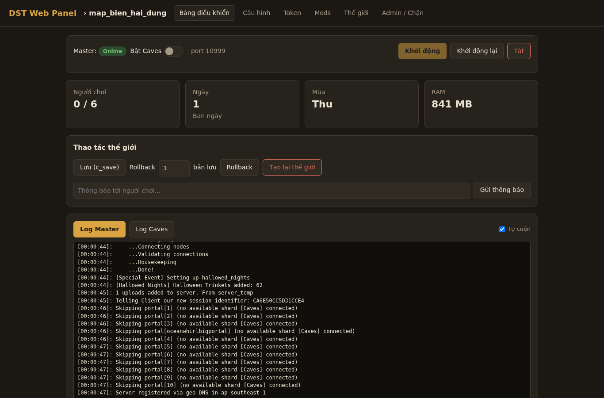
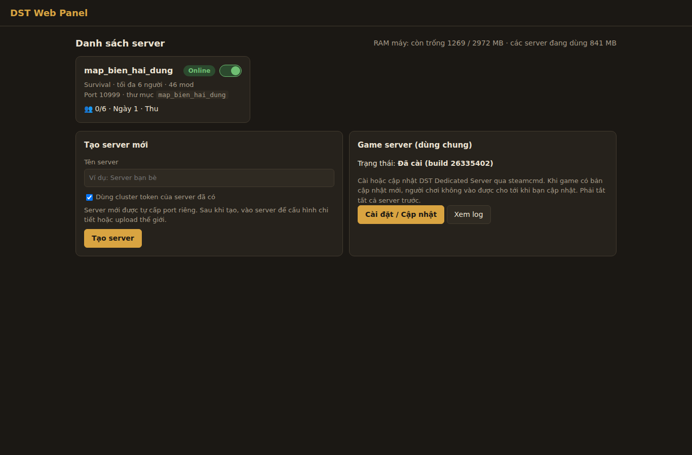
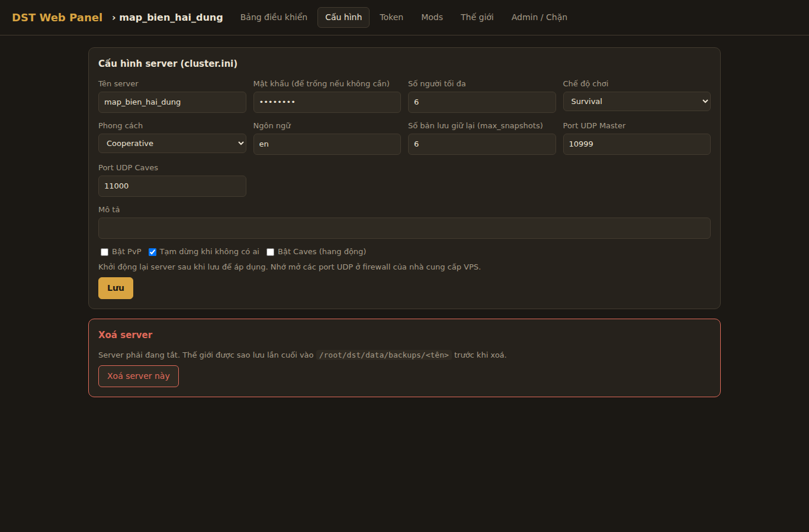
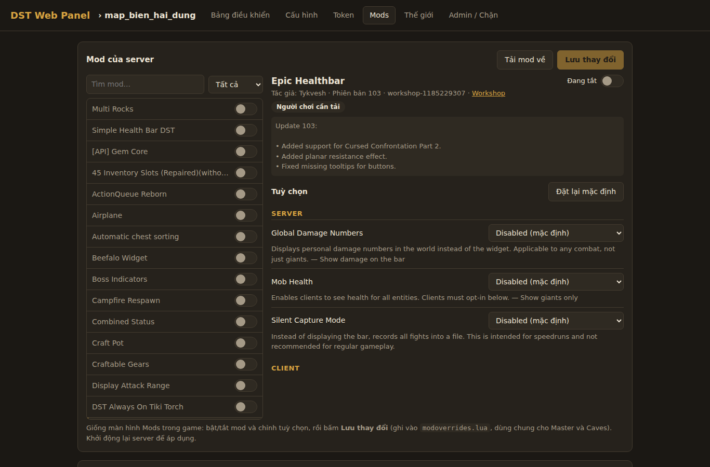
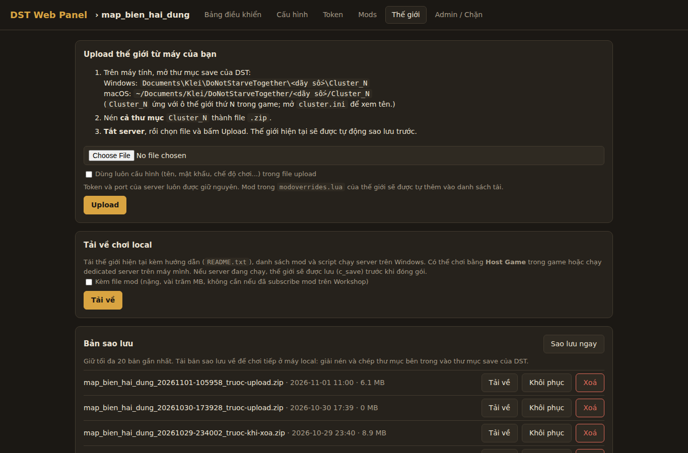

# DST Dedicated Linux Server Manager

**Tiếng Việt** | [English](README.en.md)



Web panel quản lý nhiều **Don't Starve Together Dedicated Server** trên Linux. Viết bằng Python (FastAPI), một file `app.py` và một trang `static/index.html`, không cần database.

Cách quản lý shard (gửi lệnh qua stdin, đọc log, chèn Lua để lấy thống kê) tham khảo từ [vox-launcher](https://github.com/diogo-webber/vox-launcher), viết lại cho Linux và chạy trên web.

## Tính năng

- **Nhiều server trên một máy**: mỗi server (cluster) có Master + Caves (tuỳ chọn) và được tự cấp một bộ port riêng, không bị trùng.
- **Cài và cập nhật game**: tự tải SteamCMD và DST Dedicated Server (app 343050). Panel kiểm tra bản mới mỗi 30 phút. Khi không còn ai chơi, nó tự restart server để cập nhật.
- **Dashboard**: bật/tắt/restart từng server, bật/tắt Caves, xem log từng shard theo thời gian thực, gửi lệnh console, xem số người chơi và thống kê.
- **Thao tác thế giới**: save, rollback (1–10 bản), tạo lại thế giới, gửi thông báo trong game.
- **Cấu hình**: sửa `cluster.ini` qua form (tên, mô tả, mật khẩu, chế độ chơi, số người, PvP...), sửa `worldgenoverride.lua` cho mặt đất và hang động.
- **Mod Workshop**: thêm mod theo ID, tải mod bằng SteamCMD, chỉnh cấu hình mod ngay trên web (đọc `modinfo.lua` trong sandbox Lua), file `modoverrides.lua` được đồng bộ sang Caves.
- **Danh sách người chơi**: adminlist, blocklist, whitelist.
- **Cluster token**: nhập token và có thể dùng lại token khi tạo server mới.
- **Sao lưu**: tạo, tải về, khôi phục và xoá bản sao lưu (giữ 20 bản gần nhất).
- **Upload thế giới**: tải file `.zip` lên (tối đa 1 GB) để nhập một thế giới từ máy của bạn.
- **Tải về chơi local**: xuất server thành gói zip (có thể kèm mod) với hướng dẫn và `start_server.bat` để chơi tiếp trên Windows/macOS.
- **Đăng nhập**: dùng HTTP Basic Auth.

## Ảnh chụp màn hình

| Danh sách server | Cấu hình |
|---|---|
|  |  |
| **Mods** | **Thế giới & sao lưu** |
|  |  |

## Yêu cầu

- Linux x86_64 (đã chạy thử trên Ubuntu)
- Python 3.10 trở lên
- Thư viện 32-bit cho SteamCMD, ví dụ trên Ubuntu/Debian:

  ```bash
  sudo dpkg --add-architecture i386
  sudo apt update
  sudo apt install lib32gcc-s1 libcurl4-gnutls-dev:i386 python3-venv
  ```

- Khoảng 5–10 GB ổ đĩa trống cho game và mod

## Cấu trúc thư mục

Mặc định panel dùng thư mục `/root/dst`. Có thể đổi bằng biến môi trường `DST_BASE`.

```
/root/dst/
├── webui/      # repo này
├── server/     # DST Dedicated Server (panel tự cài)
├── steamcmd/   # SteamCMD (panel tự tải)
├── workshop/   # mod tải từ Workshop
└── data/
    ├── DoNotStarveTogether/   # các cluster
    └── backups/               # bản sao lưu
```

## Cài đặt

```bash
mkdir -p /root/dst && cd /root/dst
git clone git@github.com:phanhoanghai90/dst_dedicated_linux_server_manager.git webui
cd webui

python3 -m venv .venv
.venv/bin/pip install -r requirements.txt
```

Chạy thử:

```bash
.venv/bin/python app.py
```

Mở `http://<ip-server>:8080`. Lần chạy đầu tiên, panel tạo file `config.json` chứa tài khoản `admin` với mật khẩu ngẫu nhiên:

```bash
cat config.json
```

Muốn đổi tài khoản thì sửa file này rồi khởi động lại panel. File này đã nằm trong `.gitignore`.

Tiếp theo, trên web:

1. Bấm cài game server (lần đầu mất vài phút).
2. Tạo server mới.
3. Vào tab **Token** để nhập cluster token. Lấy token trong game: *Account → Generate Server Token*, hoặc tại [accounts.klei.com](https://accounts.klei.com/account/game/servers?game=DontStarveTogether).
4. Bật server.

## Chạy như service (systemd)

```bash
cp deploy/dst-webui.service /etc/systemd/system/
systemctl daemon-reload
systemctl enable --now dst-webui
```

Nếu cài ở thư mục khác `/root/dst/webui`, hãy sửa `WorkingDirectory` và `ExecStart` trong file service.

Để khởi động lại panel, chạy `./restart.sh`. Lưu ý: các server game đang chạy cũng sẽ được lưu và tắt theo.

Xem log:

```bash
journalctl -u dst-webui -f
```

## Biến môi trường

| Biến       | Mặc định    | Ý nghĩa                         |
|------------|-------------|---------------------------------|
| `DST_BASE` | `/root/dst` | Thư mục gốc chứa game và dữ liệu |
| `HOST`     | `0.0.0.0`   | Địa chỉ panel lắng nghe          |
| `PORT`     | `8080`      | Port của web panel               |

## Port cần mở

Port **8080/TCP** dùng cho web panel. Các port game dùng **UDP**, mỗi server chiếm một slot (`n` = 0, 1, 2...):

| Shard  | server_port     | master_server_port | authentication_port |
|--------|-----------------|--------------------|---------------------|
| Master | `10999 + 2n`    | `27018 + 2n`       | `8768 + 2n`         |
| Caves  | `11000 + 2n`    | `27019 + 2n`       | `8769 + 2n`         |

Ví dụ với `ufw`, mở cho 5 server đầu:

```bash
ufw allow 8080/tcp
ufw allow 10999:11008/udp
ufw allow 27018:27027/udp
ufw allow 8768:8777/udp
```

## Bảo mật

- Basic Auth chỉ mã hoá được khi chạy qua HTTPS. Nếu mở panel ra Internet, nên đặt sau reverse proxy có TLS (Caddy, Nginx) hoặc chỉ truy cập qua VPN/SSH tunnel.
- Mặc định service chạy bằng `root`. Có thể tạo user riêng và đổi `DST_BASE` nếu muốn giới hạn quyền.

## Ghi chú

Don't Starve Together là thương hiệu của Klei Entertainment. Dự án này không liên quan đến Klei.

## DST Launcher (app Windows, thay cho vox-launcher)

App giao diện PyQt5 (`dst_desktop.py`) dùng chung lõi với web panel (`app.py`): tạo và chạy dedicated server ở máy local, đủ tính năng như web (mod và cấu hình mod, cấu hình server, log, console, sao lưu, nhập thế giới...). Dữ liệu nằm ở `%LOCALAPPDATA%\DSTLauncher`.

**Liên kết với VPS** (mục "Liên kết VPS" ở thanh bên):

- Nhập địa chỉ + tài khoản web panel, bấm **Đồng bộ**: app tạo ở máy local các server giống hệt trên web (cùng ID, cluster token, mod, Caves) và lấy thế giới về.
- Khi mở app: đồng bộ thế giới 2 chiều, rồi cứ 10 phút một lần (đổi được).
- Khi bật một server ở máy local: dừng server đó trên VPS trước (không bật nếu trên VPS đang có người chơi), lấy thế giới mới nhất về rồi mới khởi chạy.
- Khi đóng app: lưu và tắt server local, đồng bộ lần cuối, bật lại server trên VPS mà app đã dừng.
- App tắt ngang hoặc mất mạng quá 5 phút: web panel trên VPS tự bật lại server mà app đã dừng (cần cập nhật web panel trên VPS lên bản mới).
- Không dùng chung với agent PowerShell (`sync_agent/`) cho cùng một server.

**Build exe**: trên Windows chạy `build_desktop.bat` (cần Python 3.12 64-bit) → `dist\DSTLauncher.exe`. Hoặc đẩy một tag `launcher-v*` lên GitHub: workflow "Build DST Launcher (Windows)" tự build và đính exe vào mục Releases.
